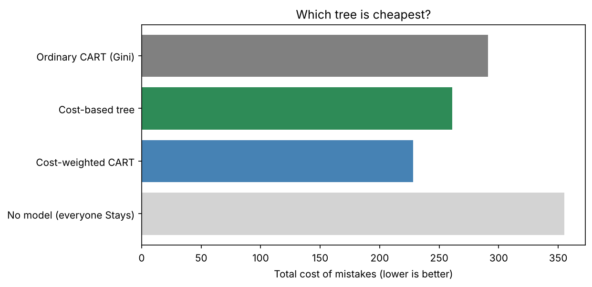
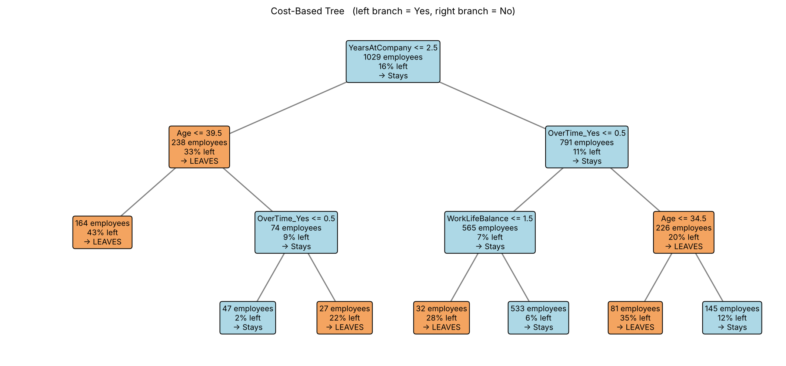
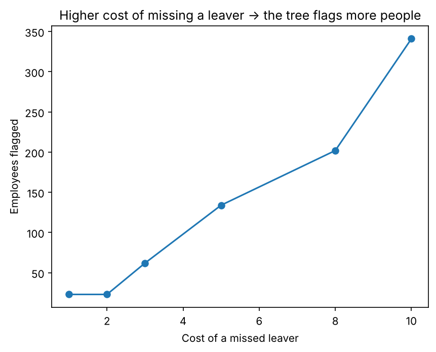

# Employee Attrition: When a Missed Leaver Costs More Than a False Alarm

Most classification models treat every mistake the same. HR does not. Having a retention conversation with someone who was never going to leave costs a little time. Missing someone who does leave means recruiting, hiring and training a replacement.

This project asks a simple question: **if we build the decision tree around that cost difference, does it make better decisions than a standard tree?**

I used the IBM HR attrition dataset (1,470 employees) and compared three trees that share the same size limits, so any difference comes from how they choose splits and labels.

## The cost assumption

| | Predicted: Stays | Predicted: Leaves |
|---|---|---|
| **Actually stays** | correct (0) | false alarm (cost **1**) |
| **Actually leaves** | missed leaver (cost **5**) | correct (0) |

The 1 to 5 ratio is an assumption I picked for the exercise. In a real project this is the first number you would ask the business for. Both values are set at the top of the script and notebook, so you can change them and re-run.

## The three models

| | Ordinary CART | Cost-based tree | Cost-weighted CART |
|---|---|---|---|
| Splitting rule | Gini (purity) | Total cost of mistakes | Gini on cost-weighted data |
| Leaf label | Majority class (> 50% leave) | Cheaper label (> 1 in 6 leave here) | Weighted majority |
| Uses the cost matrix? | No | Yes | Yes, as weights |
| Library | scikit-learn | empulse | scikit-learn |

All three use `max_depth=3`, `min_samples_leaf=20`, and a 70/30 stratified split with `random_state=42`.

## Results (test set, 441 employees, 71 of whom left)

| Model | Accuracy | Leavers caught | Leavers missed | False alarms | Total cost |
|---|---|---|---|---|---|
| Ordinary CART (Gini) | 0.830 | 17 | 54 | 21 | 291 |
| Cost-based tree | 0.707 | 38 | 33 | 96 | 261 |
| Cost-weighted CART | 0.737 | 43 | 28 | 88 | **228** |
| No model (everyone stays) | 0.839 | 0 | 71 | 0 | 355 |



A few things stand out:

- **Accuracy points the wrong way.** Predicting that nobody leaves has the highest accuracy (84%) and the highest cost. The ordinary tree looks good at 83% but only finds 17 of the 71 leavers.
- **Cost-weighted CART was the cheapest**, about 22% below the ordinary tree and 36% below doing nothing.
- **The pure cost criterion landed in the middle** (about 10% below the ordinary tree). It only rewards a split when it changes a group's label, so it can skip a split that would set up a better one lower down. Gini changes smoothly, which is why the weighted version did better here. On other data or settings that order could change, so it is worth testing both.

## Gini and cost disagree on the very first split

For five candidate questions, I measured how much each criterion improves the split:

| Question | Group size | Leaver rate | Gini drop | Cost drop |
|---|---|---|---|---|
| OverTime = Yes | 302 | 0.28 | 0.0127 | 214 |
| YearsAtCompany <= 2 | 238 | 0.33 | 0.0167 | **230** |
| TotalWorkingYears <= 2 | 81 | 0.53 | **0.0233** | 177 |
| JobLevel = 1 | 362 | 0.27 | 0.0117 | 214 |
| MonthlyIncome <= 3000 | 260 | 0.30 | 0.0130 | 208 |

Gini likes `TotalWorkingYears <= 2`: a small, very pure group where 53% leave. The cost criterion prefers `YearsAtCompany <= 2`: a bigger group (238 people, 33% leave) where flagging everyone catches many more leavers for an acceptable number of false alarms.

## Who the cost-based tree flags



- 2 years or less at the company and aged 39 or younger (43% left)
- Newer employees over 39 who work overtime (22% left)
- Longer-serving employees with no overtime but the lowest work-life balance rating (28% left)
- Longer-serving employees aged 34 or younger who work overtime (35% left)

In none of these groups do most people leave. The tree still says "Leaves" because once more than 1 in 6 are likely to go, acting is cheaper than doing nothing. With a 1 to 5 cost ratio the threshold is 1 / (1 + 5) = 0.167, rather than the 0.5 an ordinary tree uses.

## What happens if the cost changes?

I rebuilt the cost-based tree for different costs of a missed leaver (false alarm fixed at 1):

| Cost of a missed leaver | Employees flagged | Leavers caught | Leavers missed |
|---|---|---|---|
| 1 | 23 | 7 | 64 |
| 2 | 23 | 7 | 64 |
| 3 | 62 | 21 | 50 |
| 5 | 134 | 38 | 33 |
| 8 | 202 | 49 | 22 |
| 10 | 341 | 64 | 7 |



At a cost of 10 the tree flags 77% of the test employees. That is a fair reminder that the cost matrix is a management decision, not a statistical one. Before a model like this is used, HR needs a realistic number for replacing an employee and another for a retention action.

## Repo layout

```
.
├── data/
│   ├── HR-Employee-Attrition.csv
│   └── README.md
├── notebooks/
│   └── cost_based_splitting_hr_attrition.ipynb   # step-by-step walkthrough with outputs
├── src/
│   └── cost_based_attrition.py                   # same analysis as a runnable script
├── reports/figures/                              # charts used in this README
├── results/                                      # tables saved as CSV
├── requirements.txt
├── LICENSE
└── README.md
```

## Running it

```bash
git clone <this-repo-url>
cd <repo-folder>
pip install -r requirements.txt

# option 1: the notebook
jupyter notebook notebooks/cost_based_splitting_hr_attrition.ipynb

# option 2: the script (saves figures and CSVs)
python src/cost_based_attrition.py
```

## Limitations

- One train/test split. With 71 leavers in the test set, small changes in the data could move the ranking between the two cost-aware trees. Cross-validation would be the next step.
- Trees are limited to depth 3 so they can be read and explained. A deeper tree or an ensemble would likely score better but would be harder to explain to an HR team.
- The costs are assumed, not estimated. The IBM dataset is fictional and has no salary, recruitment or training cost data to ground them.
- The model flags groups of people. It should support a conversation about retention, not decide anything about an individual.

## Tools

Python, pandas, scikit-learn, matplotlib, [empulse](https://github.com/ShimantoRahman/empulse) (for `CSTreeClassifier`).
